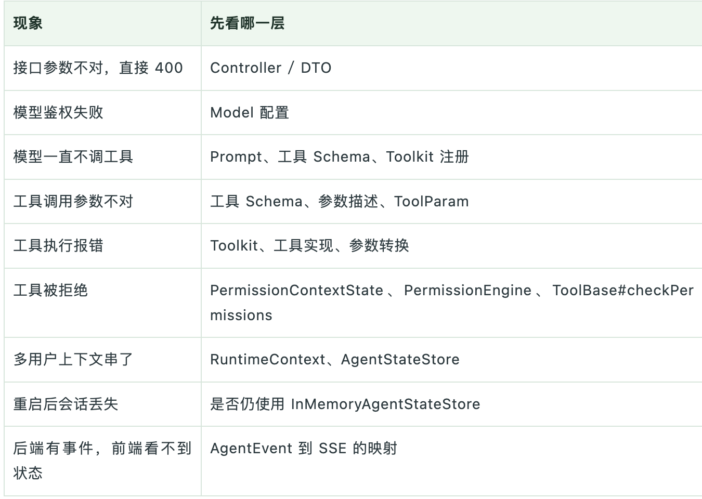

## 运行main方法后
### 1、创建以下请求
```shell
curl -N -X POST "http://localhost:8080/dev-agent/ask" \
-H "Content-Type:application/json" \
-d '{
"userId":"dev-user-001",
"sessionId":"dev-session-001",
"message":"帮我整理一份今天排查订单接口超时的执行清单"
}'
```
-N 会关闭 curl 的输出缓冲。
终端会先拿到 SESSION，随后持续收到模型文本；请求正常完成时，最后收到 DONE。
模型每次吐出的片段不固定，可能是一个词，也可能只有一两个字。示例里把部分连续片段合并展示：

```text
data:{"type":"SESSION","sessionId":"dev-session-001","content":""}

data:{"type":"MESSAGE","sessionId":"dev-session-001","content":"1"}

data:{"type":"MESSAGE","sessionId":"dev-session-001","content":"."}

data:{"type":"MESSAGE","sessionId":"dev-session-001","content":" "}

data:{"type":"MESSAGE","sessionId":"dev-session-001","content":"补充"}

data:{"type":"MESSAGE","sessionId":"dev-session-001","content":"并"}

data:{"type":"MESSAGE","sessionId":"dev-session-001","content":"记录"}

data:{"type":"MESSAGE","sessionId":"dev-session-001","content":"超"}

data:{"type":"MESSAGE","sessionId":"dev-session-001","content":"时"}

data:{"type":"MESSAGE","sessionId":"dev-session-001","content":"订单"}

data:{"type":"MESSAGE","sessionId":"dev-session-001","content":"接口"}

data:{"type":"MESSAGE","sessionId":"dev-session-001","content":"的名称"}

data:{"type":"MESSAGE","sessionId":"dev-session-001","content":"、"}

data:{"type":"MESSAGE","sessionId":"dev-session-001","content":"发生"}

data:{"type":"MESSAGE","sessionId":"dev-session-001","content":"时间段"}

data:{"type":"MESSAGE","sessionId":"dev-session-001","content":"、"}

data:{"type":"MESSAGE","sessionId":"dev-session-001","content":"超"}

data:{"type":"MESSAGE","sessionId":"dev-session-001","content":"时"}

data:{"type":"MESSAGE","sessionId":"dev-session-001","content":"阈值"}

data:{"type":"MESSAGE","sessionId":"dev-session-001","content":"、"}

data:{"type":"MESSAGE","sessionId":"dev-session-001","content":"错误"}

data:{"type":"MESSAGE","sessionId":"dev-session-001","content":"码"}

data:{"type":"MESSAGE","sessionId":"dev-session-001","content":"及"}

data:{"type":"MESSAGE","sessionId":"dev-session-001","content":"可用"}

data:{"type":"MESSAGE","sessionId":"dev-session-001","content":"请求"}

data:{"type":"MESSAGE","sessionId":"dev-session-001","content":"样本"}

data:{"type":"MESSAGE","sessionId":"dev-session-001","content":"或"}

data:{"type":"MESSAGE","sessionId":"dev-session-001","content":" trace"}

data:{"type":"MESSAGE","sessionId":"dev-session-001","content":" ID"}

data:{"type":"MESSAGE","sessionId":"dev-session-001","content":"。\n"}

data:{"type":"MESSAGE","sessionId":"dev-session-001","content":"2"}

data:{"type":"MESSAGE","sessionId":"dev-session-001","content":"."}

data:{"type":"MESSAGE","sessionId":"dev-session-001","content":" "}

data:{"type":"MESSAGE","sessionId":"dev-session-001","content":"拉"}

data:{"type":"MESSAGE","sessionId":"dev-session-001","content":"取"}

data:{"type":"MESSAGE","sessionId":"dev-session-001","content":"该"}

data:{"type":"MESSAGE","sessionId":"dev-session-001","content":"时间段"}

data:{"type":"MESSAGE","sessionId":"dev-session-001","content":"订单"}

data:{"type":"MESSAGE","sessionId":"dev-session-001","content":"接口"}

data:{"type":"MESSAGE","sessionId":"dev-session-001","content":"的"}

data:{"type":"MESSAGE","sessionId":"dev-session-001","content":"调用"}

data:{"type":"MESSAGE","sessionId":"dev-session-001","content":"量"}

data:{"type":"MESSAGE","sessionId":"dev-session-001","content":"、"}

data:{"type":"MESSAGE","sessionId":"dev-session-001","content":"P"}

data:{"type":"MESSAGE","sessionId":"dev-session-001","content":"95"}

data:{"type":"MESSAGE","sessionId":"dev-session-001","content":"/P"}

data:{"type":"MESSAGE","sessionId":"dev-session-001","content":"99"}

data:{"type":"MESSAGE","sessionId":"dev-session-001","content":" "}

data:{"type":"MESSAGE","sessionId":"dev-session-001","content":"延迟"}

data:{"type":"MESSAGE","sessionId":"dev-session-001","content":"、"}

data:{"type":"MESSAGE","sessionId":"dev-session-001","content":"错误"}

data:{"type":"MESSAGE","sessionId":"dev-session-001","content":"率"}

data:{"type":"MESSAGE","sessionId":"dev-session-001","content":"及"}

data:{"type":"MESSAGE","sessionId":"dev-session-001","content":"限"}

data:{"type":"MESSAGE","sessionId":"dev-session-001","content":"流"}

data:{"type":"MESSAGE","sessionId":"dev-session-001","content":"/"}

data:{"type":"MESSAGE","sessionId":"dev-session-001","content":"熔"}

data:{"type":"MESSAGE","sessionId":"dev-session-001","content":"断"}

data:{"type":"MESSAGE","sessionId":"dev-session-001","content":"触发"}

data:{"type":"MESSAGE","sessionId":"dev-session-001","content":"记录"}

data:{"type":"MESSAGE","sessionId":"dev-session-001","content":"。\n"}

data:{"type":"MESSAGE","sessionId":"dev-session-001","content":"3"}

data:{"type":"MESSAGE","sessionId":"dev-session-001","content":"."}

data:{"type":"MESSAGE","sessionId":"dev-session-001","content":" "}

data:{"type":"MESSAGE","sessionId":"dev-session-001","content":"对比"}

data:{"type":"MESSAGE","sessionId":"dev-session-001","content":"订单"}

data:{"type":"MESSAGE","sessionId":"dev-session-001","content":"接口"}

data:{"type":"MESSAGE","sessionId":"dev-session-001","content":"依赖"}

data:{"type":"MESSAGE","sessionId":"dev-session-001","content":"的"}

data:{"type":"MESSAGE","sessionId":"dev-session-001","content":"数据库"}

data:{"type":"MESSAGE","sessionId":"dev-session-001","content":"、"}

data:{"type":"MESSAGE","sessionId":"dev-session-001","content":"缓存"}

data:{"type":"MESSAGE","sessionId":"dev-session-001","content":"、"}

data:{"type":"MESSAGE","sessionId":"dev-session-001","content":"消息"}

data:{"type":"MESSAGE","sessionId":"dev-session-001","content":"队列"}

data:{"type":"MESSAGE","sessionId":"dev-session-001","content":"和"}

data:{"type":"MESSAGE","sessionId":"dev-session-001","content":"下游"}

data:{"type":"MESSAGE","sessionId":"dev-session-001","content":"服务"}

data:{"type":"MESSAGE","sessionId":"dev-session-001","content":"在同一"}

data:{"type":"MESSAGE","sessionId":"dev-session-001","content":"时间"}

data:{"type":"MESSAGE","sessionId":"dev-session-001","content":"段的"}

data:{"type":"MESSAGE","sessionId":"dev-session-001","content":"延迟"}

data:{"type":"MESSAGE","sessionId":"dev-session-001","content":"与"}

data:{"type":"MESSAGE","sessionId":"dev-session-001","content":"错误"}

data:{"type":"MESSAGE","sessionId":"dev-session-001","content":"指标"}

data:{"type":"MESSAGE","sessionId":"dev-session-001","content":"。\n"}

data:{"type":"MESSAGE","sessionId":"dev-session-001","content":"4"}

data:{"type":"MESSAGE","sessionId":"dev-session-001","content":"."}

data:{"type":"MESSAGE","sessionId":"dev-session-001","content":" "}

data:{"type":"MESSAGE","sessionId":"dev-session-001","content":"检查"}

data:{"type":"MESSAGE","sessionId":"dev-session-001","content":"应用"}

data:{"type":"MESSAGE","sessionId":"dev-session-001","content":"侧"}

data:{"type":"MESSAGE","sessionId":"dev-session-001","content":"线程"}

data:{"type":"MESSAGE","sessionId":"dev-session-001","content":"池"}

data:{"type":"MESSAGE","sessionId":"dev-session-001","content":"、"}

data:{"type":"MESSAGE","sessionId":"dev-session-001","content":"连接"}

data:{"type":"MESSAGE","sessionId":"dev-session-001","content":"池"}

data:{"type":"MESSAGE","sessionId":"dev-session-001","content":"、"}

data:{"type":"MESSAGE","sessionId":"dev-session-001","content":"GC"}

data:{"type":"MESSAGE","sessionId":"dev-session-001","content":"、"}

data:{"type":"MESSAGE","sessionId":"dev-session-001","content":"CPU"}

data:{"type":"MESSAGE","sessionId":"dev-session-001","content":"、"}

data:{"type":"MESSAGE","sessionId":"dev-session-001","content":"内存"}

data:{"type":"MESSAGE","sessionId":"dev-session-001","content":"及"}

data:{"type":"MESSAGE","sessionId":"dev-session-001","content":"慢"}

data:{"type":"MESSAGE","sessionId":"dev-session-001","content":"请求"}

data:{"type":"MESSAGE","sessionId":"dev-session-001","content":"日志"}

data:{"type":"MESSAGE","sessionId":"dev-session-001","content":"。\n"}

data:{"type":"MESSAGE","sessionId":"dev-session-001","content":"5"}

data:{"type":"MESSAGE","sessionId":"dev-session-001","content":"."}

data:{"type":"MESSAGE","sessionId":"dev-session-001","content":" "}

data:{"type":"MESSAGE","sessionId":"dev-session-001","content":"核对"}

data:{"type":"MESSAGE","sessionId":"dev-session-001","content":"当天"}

data:{"type":"MESSAGE","sessionId":"dev-session-001","content":"发布"}

data:{"type":"MESSAGE","sessionId":"dev-session-001","content":"记录"}

data:{"type":"MESSAGE","sessionId":"dev-session-001","content":"、"}

data:{"type":"MESSAGE","sessionId":"dev-session-001","content":"配置"}

data:{"type":"MESSAGE","sessionId":"dev-session-001","content":"变更"}

data:{"type":"MESSAGE","sessionId":"dev-session-001","content":"、"}

data:{"type":"MESSAGE","sessionId":"dev-session-001","content":"流量"}

data:{"type":"MESSAGE","sessionId":"dev-session-001","content":"峰值"}

data:{"type":"MESSAGE","sessionId":"dev-session-001","content":"和"}

data:{"type":"MESSAGE","sessionId":"dev-session-001","content":"定时"}

data:{"type":"MESSAGE","sessionId":"dev-session-001","content":"任务"}

data:{"type":"MESSAGE","sessionId":"dev-session-001","content":"是否"}

data:{"type":"MESSAGE","sessionId":"dev-session-001","content":"与"}

data:{"type":"MESSAGE","sessionId":"dev-session-001","content":"超"}

data:{"type":"MESSAGE","sessionId":"dev-session-001","content":"时"}

data:{"type":"MESSAGE","sessionId":"dev-session-001","content":"时间"}

data:{"type":"MESSAGE","sessionId":"dev-session-001","content":"窗"}

data:{"type":"MESSAGE","sessionId":"dev-session-001","content":"重合"}

data:{"type":"MESSAGE","sessionId":"dev-session-001","content":"。\n"}

data:{"type":"MESSAGE","sessionId":"dev-session-001","content":"6"}

data:{"type":"MESSAGE","sessionId":"dev-session-001","content":"."}

data:{"type":"MESSAGE","sessionId":"dev-session-001","content":" "}

data:{"type":"MESSAGE","sessionId":"dev-session-001","content":"若"}

data:{"type":"MESSAGE","sessionId":"dev-session-001","content":"信息"}

data:{"type":"MESSAGE","sessionId":"dev-session-001","content":"仍"}

data:{"type":"MESSAGE","sessionId":"dev-session-001","content":"不足"}

data:{"type":"MESSAGE","sessionId":"dev-session-001","content":"，"}

data:{"type":"MESSAGE","sessionId":"dev-session-001","content":"补充"}

data:{"type":"MESSAGE","sessionId":"dev-session-001","content":"监控"}

data:{"type":"MESSAGE","sessionId":"dev-session-001","content":"/"}

data:{"type":"MESSAGE","sessionId":"dev-session-001","content":"日志"}

data:{"type":"MESSAGE","sessionId":"dev-session-001","content":"入口"}

data:{"type":"MESSAGE","sessionId":"dev-session-001","content":"、"}

data:{"type":"MESSAGE","sessionId":"dev-session-001","content":"可"}

data:{"type":"MESSAGE","sessionId":"dev-session-001","content":"复"}

data:{"type":"MESSAGE","sessionId":"dev-session-001","content":"现"}

data:{"type":"MESSAGE","sessionId":"dev-session-001","content":"请求"}

data:{"type":"MESSAGE","sessionId":"dev-session-001","content":"和"}

data:{"type":"MESSAGE","sessionId":"dev-session-001","content":"完整"}

data:{"type":"MESSAGE","sessionId":"dev-session-001","content":"链路"}

data:{"type":"MESSAGE","sessionId":"dev-session-001","content":" trace"}

data:{"type":"MESSAGE","sessionId":"dev-session-001","content":" "}

data:{"type":"MESSAGE","sessionId":"dev-session-001","content":"后"}

data:{"type":"MESSAGE","sessionId":"dev-session-001","content":"继续"}

data:{"type":"MESSAGE","sessionId":"dev-session-001","content":"定位"}

data:{"type":"MESSAGE","sessionId":"dev-session-001","content":"。"}

data:{"type":"DONE","sessionId":"dev-session-001","content":""}
```

模型回答的具体措辞不固定，但方向应该是一份排查清单，而且不能声称已经读取日志、执行命令或定位出具体故障。
再用同一个 userId 和 sessionId 问一句：
```shell
curl -N -X POST "http://localhost:8080/dev-agent/ask" \
 -H "Content-Type:application/json" \
 -d '{
    "userId":"dev-user-001",
    "sessionId":"dev-session-001",
    "message":"我刚才让你整理的是什么任务？一句话回答"
 }'
```
状态正常时，模型会知道上一轮是在整理“订单接口超时”的排查清单。
```text
data:{"type":"SESSION","sessionId":"dev-session-001","content":""}

data:{"type":"MESSAGE","sessionId":"dev-session-001","content":"你"}

data:{"type":"MESSAGE","sessionId":"dev-session-001","content":"让我"}

data:{"type":"MESSAGE","sessionId":"dev-session-001","content":"整理"}

data:{"type":"MESSAGE","sessionId":"dev-session-001","content":"今天"}

data:{"type":"MESSAGE","sessionId":"dev-session-001","content":"排查"}

data:{"type":"MESSAGE","sessionId":"dev-session-001","content":"订单"}

data:{"type":"MESSAGE","sessionId":"dev-session-001","content":"接口"}

data:{"type":"MESSAGE","sessionId":"dev-session-001","content":"超"}

data:{"type":"MESSAGE","sessionId":"dev-session-001","content":"时的"}

data:{"type":"MESSAGE","sessionId":"dev-session-001","content":"执行"}

data:{"type":"MESSAGE","sessionId":"dev-session-001","content":"清单"}

data:{"type":"MESSAGE","sessionId":"dev-session-001","content":"。"}

data:{"type":"DONE","sessionId":"dev-session-001","content":""}
```

再换一个 sessionId：
```shell
curl -N -X POST "http://localhost:8080/dev-agent/ask" \
 -H "Content-Type:application/json" \
 -d '{
    "userId":"dev-user-001",
    "sessionId":"dev-session-002",
    "message":"我刚才让你整理的是什么任务？不知道就说不知道"
 }'
```
这次它不应该拿到上一段会话里的内容。
```text
data:{"type":"SESSION","sessionId":"dev-session-002","content":""}

data:{"type":"MESSAGE","sessionId":"dev-session-002","content":"检查"}

data:{"type":"MESSAGE","sessionId":"dev-session-002","content":"当前"}

data:{"type":"MESSAGE","sessionId":"dev-session-002","content":"会话"}

data:{"type":"MESSAGE","sessionId":"dev-session-002","content":"记录"}

data:{"type":"MESSAGE","sessionId":"dev-session-002","content":"："}

data:{"type":"MESSAGE","sessionId":"dev-session-002","content":"无法"}

data:{"type":"MESSAGE","sessionId":"dev-session-002","content":"确认"}

data:{"type":"MESSAGE","sessionId":"dev-session-002","content":"你"}

data:{"type":"MESSAGE","sessionId":"dev-session-002","content":"此前"}

data:{"type":"MESSAGE","sessionId":"dev-session-002","content":"要求"}

data:{"type":"MESSAGE","sessionId":"dev-session-002","content":"整理"}

data:{"type":"MESSAGE","sessionId":"dev-session-002","content":"的任务"}

data:{"type":"MESSAGE","sessionId":"dev-session-002","content":"，"}

data:{"type":"MESSAGE","sessionId":"dev-session-002","content":"请"}

data:{"type":"MESSAGE","sessionId":"dev-session-002","content":"补充"}

data:{"type":"MESSAGE","sessionId":"dev-session-002","content":"原始"}

data:{"type":"MESSAGE","sessionId":"dev-session-002","content":"问题"}

data:{"type":"MESSAGE","sessionId":"dev-session-002","content":"描述"}

data:{"type":"MESSAGE","sessionId":"dev-session-002","content":"。"}

data:{"type":"DONE","sessionId":"dev-session-002","content":""}
```

这两个测试比只看第一段输出更关键。它能说明 RuntimeContext 和 AgentStateStore 已经参与执行，而不只是把模型返回包装成 SSE。


## ReActAgent：里面这一层跑推理-行动循环
ReActAgent 是 AgentScope Java 的核心执行器。
这里的 ReAct，不要理解成“框架会暴露模型的完整思维链”。更准确地说，它描述的是一种运行节奏：

```text
模型判断下一步
-> 需要工具就发起工具调用
-> 应用执行工具
-> 工具结果回到上下文
-> 模型继续判断
```

这条链路大致对应两个方法：
```text
reasoning(...)：调用模型，处理模型回复
acting(...)：执行工具，把工具结果写回上下文
```

ReActAgent 不绑定某一家模型服务。底层可以是 DeepSeek、DashScope、OpenAI 兼容接口，
也可以是别的模型实现。它依赖的是 Model 接口：
```java
Flux<ChatResponse> stream(
        List<Msg> messages,
        List<ToolSchema> tools,
        GenerateOptions options);
```
模型接收消息和工具 Schema，返回 ChatResponse 流。需要调用工具时，ToolUseBlock 会出现在响应内容里。

接入工具后，路径会展开：
```text
用户消息
-> reasoning
-> Model.stream(...) 返回 ChatResponse流
-> 响应内容中出现 ToolUseBlock
-> acting
-> 权限判断
-> Toolkit 执行工具
-> ToolResultBlock 写回上下文
-> 下一轮 reasoning
-> 最终回答
```

举个具体例子。
用户问：
```text
这个项目用了哪个 Java 版本，启动类在哪里？
```

如果应用提前在 Toolkit 里注册了 read_pom 和 find_main_class 这两个 Java 工具，模型看到的就不只是 Prompt，还有工具名称、描述和参数 Schema。
```text
模型先判断：需要查 pom.xml 和启动类
-> 生成 read_pom / find_main_class 调用请求
-> Toolkit 执行 Java 方法
-> 返回 pom.xml 内容和启动类路径
-> 模型基于工具结果组织回答
```
回答不对，不一定是模型不会答；也可能是工具没暴露、Schema 不清楚、权限拒绝了，或者工具结果没回到上下文。

## Toolkit：模型只提请求，应用侧执行工具
Toolkit 负责工具。
它做的事情包括：

```text
注册工具
生成工具
Schema管理工具分组
转换工具参数
执行工具方法
包装工具结果
```

比如你注册一个 Java 工具：
```java
agent.getToolkit().registerTool(projectInfoTools);
```

里面的方法可能长这样：
```java
@Tool(
        name = "read_pom",
        description = "读取当前 Maven 项目的 pom.xml",
        readOnly = true
)
public String readPom(
        @ToolParam(
                name = "max_chars",
                description = "最多返回多少个字符",
                required = false
        )
        Integer maxChars) {
    // read pom.xml
}
```
注册以后，Toolkit 会把它变成模型能理解的工具描述。
模型和应用的边界是:
```text
模型不会自己执行 Java 方法。
模型只是根据工具 Schema 生成工具调用请求。
工具执行发生在应用侧。
```

比如模型可能生成：
```json
{
  "name": "read_pom",
  "arguments": {
    "max_chars": 4000
  }
}
```
这一步还没有读取文件。

读取 pom.xml，发生在 Toolkit 执行工具的时候。
```text
在工具调用阶段，模型负责选择工具和生成参数。
应用负责校验、权限、执行和返回结果。
```

## RuntimeContext 和 AgentState：一个标记调用，一个保存进度
这两个对象别混：
```text
RuntimeContext：本次调用携带的上下文
AgentState：这段会话的执行状态
```
- RuntimeContext 是一次调用的上下文，里面带着 userId、sessionId 等信息。AgentState 保存的是会话运行状态。
- AgentState 保存会话标识、消息上下文、摘要、迭代次数，以及权限、工具、任务和 Plan Mode 等状态。下面是其中一部分字段：

```java
private String summary;
private final List<Msg> context;
private int curIter;
private PermissionContextState permissionContext;
private final ToolContextState toolContext;
private final TaskContextState tasksContext;
```

状态槽位由 userId 和 sessionId 定位：
```java
String sid = ctx != null ? ctx.getSessionId() : null;
String uid = ctx != null ? ctx.getUserId() : null;
String slot = slotKey(uid, sid);
```

同一个 Agent 实例可以服务多个会话，关键是每次调用传对上下文。userId 更建议从登录态或网关上下文里取，不要完全信任前端传来的用户标识。

如果使用 InMemoryAgentStateStore，进程一重启，状态就没了，多实例之间也不会共享。单机持久化可以使用 JsonFileAgentStateStore；多实例部署需要 Redis 等分布式 AgentStateStore。


## AgentEvent：把过程流出来，而不是只拿答案
streamEvents() 返回的是：
```java
Flux<AgentEvent>
```
这不是普通字符串流。

AgentScope Java 2.0 会把执行过程拆成事件。一次带工具的调用里，常见事件包括：

```text
AgentStartEvent
ModelCallStartEvent
TextBlockDeltaEvent
ToolCallStartEvent
ToolCallEndEvent
ToolResultStartEvent
ToolResultEndEvent
AgentResultEvent
AgentEndEvent
```
需要人工确认时，还会出现：
```text
RequireUserConfirmEvent
RequestStopEvent
```
所以前端不要只把它当“打字机效果”。原生事件可以转成业务侧 SSE 事件：
```text
MESSAGE：追加文本
TOOL_CALL_START：显示正在调用哪个工具
TOOL_RESULT_END：显示工具执行状态
REQUIRE_USER_CONFIRM：弹确认框
AGENT_RESULT：保存最终结果
DONE：关闭 loading
```

## 排查问题，先看是哪一层
Agent 项目一复杂，最怕的不是报错，而是不知道该查哪。
可以按这张表先定位：
